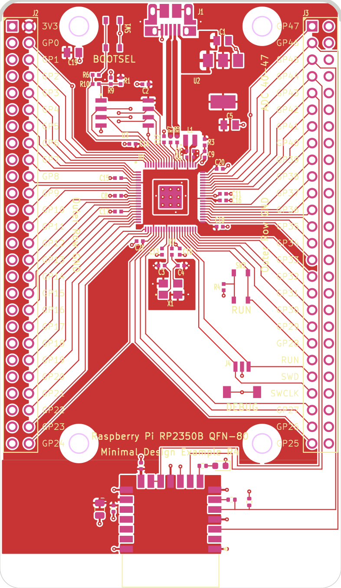

# RP2350B + RM2

Raspberry Pi's RP2350B minimal design (RPI-RP2350B-MINIMAL R4-S1, KiCad 10) with three additions:

- the **RM2** Wi-Fi/Bluetooth module (CYW43439) on **GPIO 43-46**
- the **8 MB APS6404L PSRAM** fitted on the second QSPI chip select, moved from GPIO0 to **GPIO47**
- **J5/J6**, two extra header rows below J2/J3 with **3V3** (inner column) and GND (outer column),
  so 3.3 V is easy to take off the board for level shifters and the like

That leaves **GPIO 0-42 free and in order** on the J2/J3 headers, instead of the Pico 2 W's gap
at 23/24/25/29.

Status: **schematic and layout done, DRC clean, not yet fabricated.** See "Layout" for what changed
on Pi's board.

## Pin map

| GPIO | Use |
|---|---|
| 0-42 | free, on J2/J3 (0/1 = default UART0) |
| 43 | RM2 WL_ON + BT_ON |
| 44 | RM2 gSPI CS |
| 45 | RM2 gSPI DATA: DI direct, DO through 470R (R14), IRQ through 10k (R15) |
| 46 | RM2 gSPI CLK |
| 47 | PSRAM chip select (XIP_SS_N[1]), 10k pull-up R13, 0R link R11 |

GPIO 43-47 are still wired to J3 as on Pi's board. Leave those header pins unloaded when the radio
and PSRAM are fitted.

J5 and J6 continue J2 and J3 by two rows on the same 2.54 mm grid. Each gives two 3V3 pins on the
inner column (in line with J2's 3V3 pin and the GPIO pins) and two GND pins on the outer column,
matching the outer rows above. A 2x28 header strip covers a header and its extension in one piece.

The radio circuit is the Pico 2 W's (and the RM2 datasheet's) on different pins:

- VIN and VDDIO go to +3V3, with 10u + 2x 100n local decoupling.
- WL_GPIO0 drives a green LED (D1) through 1k. That's the SDK's `CYW43_WL_GPIO_LED_PIN`.
- WL_GPIO1, WL_GPIO2 and the NC pins aren't connected.

The cyw43 driver takes any pins from the board header, so nothing else changes in firmware. On the
RP2350B a PIO block reaches either GPIO 0-31 or 16-47. The radio's PIO therefore sits in the
16-47 window, which means LED output PIOs for GPIO 0-15 must use a different PIO block.

## Using it on perfboard

On each header the inner column carries the signals: every GPIO, plus 3V3 (J2 pin 2, and J5/J6),
RUN, SWD and SWCLK. The outer column is all GND. Everything is on the 0.1" grid. The inner columns
are 1.7" (17 holes) apart and the outer columns 1.9" (19 holes).

- **Fit the inner column and only a few GND pins.** Single-row 1x28 headers on the inner columns
  carry all 48 GPIOs, 3V3, RUN and SWD, J5/J6's 3V3 included. On the outer column, a handful of
  GND pins is plenty: J5/J6's two, and a couple more on each side. All the outer pins are tied
  together by the module's ground plane. Leaving the rest off frees the hole beside every signal
  pin, so a wire can leave each one straight outward instead of threading between ground pins.
- **Socket it and wire on the underside.** Put female headers on the perfboard and plug the module
  in, then wire underneath with thin insulated wire (Kynar or wire-wrap). From below, the inner
  pins are as easy to reach as any other, and the area under the module is free routing space.
  Socketing also gives the parts on the module's underside room: U4 (the PSRAM, 1.75 mm tall
  SOIC), R11, R13 and C22. Plain header pins pushed fully home leave only about 2.5 mm.
- **Keep the antenna end clear.** Let the RM2 end overhang the perfboard edge, or keep that area
  free of wires, copper and ground. Anything conductive close under the antenna detunes it.

Two traps:

- **Stripboard (Veroboard):** run the strips outward, perpendicular to the headers, so each GPIO
  gets its own strip. Wherever an outer GND pin is fitted, it shares a strip with the inner pin of
  the same row, so cut the strip between the two columns at those rows. That includes J5/J6, whose
  rows pair 3V3 with GND: an uncut strip there shorts 3.3 V to ground.
- **Solderless breadboard:** don't. With 2-row headers, each row's inner and outer pins land in
  the same 5-hole strip and short every GPIO to GND. Even with single-row headers, the 1.7" span
  is too wide to straddle a standard breadboard.

## Files

| Path | What |
|---|---|
| `RP2350B-RM2.kicad_sch` | schematic (single sheet, A3) |
| `RP2350B-RM2.kicad_pcb` | Pi's R4 layout, 18 mm longer, plus the RM2 and the PSRAM (see "Layout") |
| `rp2350b_rm2.kicad_sym`, `rp2350b_rm2.pretty/RPi_RM2.kicad_mod` | RM2 symbol and footprint (project libraries, already in `sym-lib-table` / `fp-lib-table`) |
| `rp2350b_rm2.pretty/PinHeader_2x02_P2.54mm_Ext.kicad_mod` | J5/J6 footprint: a 2x02 header with no pin-1 marker and its silkscreen open at the top, so it reads as part of J2/J3 |
| `bom-jlcpcb.csv` | BOM with LCSC numbers |
| `firmware/boards/rp2350b_rm2.h` | pico-sdk board header (CYW43 pins, 16 MB flash, 8 MB PSRAM on GPIO47) |
| `firmware/blink/` | bring-up test: blinks D1 through the radio, so it proves the RM2 is alive |
| `tools/kisch.py`, `tools/kirender.py` | netlist dump/check and rough PNG preview of a schematic, no KiCad needed |
| `tools/rm2_footprint.py` | generator for the RM2 footprint |
| `tools/update_pcb_from_sch.py`, `tools/layout_rm2.py` | the scripted Update PCB from Schematic and RM2/PSRAM layout pass that produced the board (run once, in KiCad's Python; kept for reference) |
| `docs/schematic-*.png` | rough schematic previews (full sheet, radio, PSRAM) |
| `docs/pcb-front.png`, `docs/pcb-back.png` | board renders (front copper and silk; back copper, mirrored) |

## BOM / JLCPCB

Every part has an LCSC number except these three:

- **U5 RM2**: not stocked at LCSC. Buy Raspberry Pi SC1169 (Pimoroni, The Pi Hut, Mouser) and
  hand-solder it. The footprint's pads run 0.5 mm past the module edge to make that easier.
- **SW1/SW2** (Wurth 434133025816): not at LCSC. Use JLC global sourcing or hand-solder, or swap
  in an LCSC tact switch and change the footprint.
- **J2/J3** 2x26 headers and **J5/J6** 2x02 extensions: through-hole, hand-solder. A 2x28 strip
  covers J2+J5 (or J3+J6) in one piece.

Passives were swapped from Pi's Murata/Yageo parts to JLC basic equivalents with the same value,
size and dielectric. The 100n parts are 16 V instead of 25 V, which is fine on 3.3 V.

## Layout

The board is Pi's R4 layout with **Update PCB from Schematic** applied, and the areas below added
or changed. Every Pi footprint stays where it was apart from the bottom mounting holes (MH3, MH4).
Pi's tracks are untouched apart from the U4 fan-out and the R11 stub.

**RM2 end.** The board is 18 mm longer (89.5 x 52 mm), and the extra length is at the end away from
USB, as on the Pico 2 W. The headers stay on both long edges. The RM2 (U5) sits between them,
centred, with its antenna end (pins 1 and 21) at the new bottom edge. The module's top edge clears
Pi's "Minimal Design Example R4" silkscreen line.

- Antenna: a rule area across the full board width, from the module's antenna line to the bottom
  edge, blocks copper, tracks and vias on both layers. That covers the footprint's own keep-out plus
  the copper on either side of it.
- Ground: there's a solid back-layer GND pour under the module and a top-layer GND pour under the
  module body. Each of the six RM2 GND pads (1, 4, 7, 11, 15, 21) has its own via to the back plane,
  within 2.4 mm of the pad centre.
- gSPI: GPIO43-46 run on top copper the whole way. They use J3, where Pi has no copper: WL_ON and CS
  run in the gap between J3's two pin columns, and DI and SCLK between the outer (all-GND) column and
  the board edge. All four use Pi's 0.15 mm track and clearance. Below J3 they turn in under MH3's
  keep-out. SCLK, DI and DO land on the module's right side, and CS and WL_ON wrap over its top.
- Length: the cost of the long-board layout is length. Each gSPI net runs 114-126 mm from U1
  (Pico 2 W: a few cm), about 30 mm of which is Pi's existing U1-to-J3 routing. That's still short
  next to a clock period at cyw43's default gSPI rate. But it's around the length where fast GPIO
  edges start to ring, and SCLK has no series resistor. If the radio misbehaves at bring-up, slow
  the bus with a higher `CYW43_PIO_CLOCK_DIV_INT` before suspecting anything else.
- R14 (DO, 470R) sits 1 mm from the DO pad, and R15 (IRQ, 10k) sits next to it on GPIO45. The IRQ
  line (host wake) takes the back layer for 12 mm to get from R15 to its pad under CS. It's the
  only radio signal off the top layer.
- Power: VIN has C24 (100n) and C23 (10u) next to it, and VDDIO has C25 (100n). Both sit in the
  top-layer +3V3 pour, which joins Pi's pour above the module. A sheet-resistance estimate of that
  copper puts U2's output to the RM2's VIN at about 19 mOhm, roughly 6 mV at a 300 mA transmit
  peak.
- D1 (WL_GPIO0 LED) and R16 sit just above the module's top-right corner.

GPIO43-47 stay wired to J3's pins 1-9 as in the schematic. Leave those header pins unloaded when the
radio is fitted, as noted above. The gSPI lanes also run alongside the rest of J3's pins, so
expect a little crosstalk from SCLK onto anything wired to J3.

**Mounting holes.** MH3 and MH4 move from Pi's old bottom edge to the new end of the board, at the
same x as the top pair (86.03 and 113.97 mm) and 4 mm from the edge, again like the top pair. The
four holes keep Pi's rectangular pattern, now 27.94 x 81.5 mm. The top pair can't move into the
true corners because J2/J3 pins 1 and 2 are there. At the bottom, the holes flank the RM2's antenna
about 5 mm from its ends, as on the Pico 2 W. The antenna rule area allows them because they're
NPTH holes with no copper.

**J5/J6 (3V3 header extensions).** These sit right under J2/J3 on the same grid, with their
silkscreen joining the header outlines, and "3V3" labels in the style of Pi's GPxx labels. Their
3V3 pins connect to the top-layer +3V3 pour and their GND pins to the back plane. J6's 3V3 pins sit
between GPIO25's pin and the WL_ON lane, so they get a track into the pour and a solid (not
thermal) connection. The sheet-resistance estimate from U2's output is about 17 mOhm to J5's 3V3
pins and 20 mOhm to J6's. The WL_ON and CS lanes now turn below J6.

**U4 (PSRAM).** U4 swaps to `Package_SO:SOIC-8_3.9x4.9mm_P1.27mm` at Pi's spot on the back, under
U3. Pi's back-side fan-out vias for the second flash sat where the 150 mil pads now are. They are
replaced by five new vias between the pad rows: SD1/SD2 cross on top and drop beside U4's right
column, SD3/SCLK cross on top between those vias and drop beside the left column, and SD0 drops from
U3's SD0 run and passes under U4 on the back. Pi's FLASH2_SS run from R11/R13 now carries PSRAM_CS.

**PSRAM CS on GPIO47.** R11's old GPIO0 stub is gone. GPIO47 now reaches R11 through a via on Pi's
GPIO47 run to J3 and a back-layer track. GPIO0's own route to J2 is unchanged.

## Verification so far

- `python3 tools/kisch.py RP2350B-RM2.kicad_sch` reports no dangling pins and no multi-named nets.
  A net-by-net diff against Pi's original shows only the intended changes (RM2 nets, PSRAM CS
  GPIO0 to GPIO47, new decoupling).
- The RM2 pad positions match SparkFun's independently drawn RM2 footprint (XRP Controller) at
  every pad's inner edge.
- `firmware/blink` compiles against pico-sdk 2.3.0 with this board header.
- Checked headless with KiCad 10.0.6 (`kicad-cli` and pcbnew's Python), using the stock global
  library tables:
  - `kicad-cli pcb drc --schematic-parity --severity-all` reports 0 unconnected items and 0
    schematic-parity issues. The only remaining violations are 48 notes that the footprint library
    `RPI_COMPILED` isn't in the library table. Pi's original board has the same notes, because its
    footprints are embedded in the board.
  - `kicad-cli sch erc` reports 4 real items, in parts of the schematic this layout didn't touch: U2's
    two OUT pins tied together, U1 VREG_AVDD and #PWR16 "not driven" (power-flag nits), and one
    off-grid wire end. Everything else is the same library-table notes for Pi's libraries.
- Not yet opened in the KiCad GUI. After loading, refill zones (B) before plotting.

## License

Raspberry Pi's design is MIT (see `LICENSE-RaspberryPi.txt`); the additions here are MIT too.
The board header is BSD-3-Clause, derived from pico-sdk board headers.
